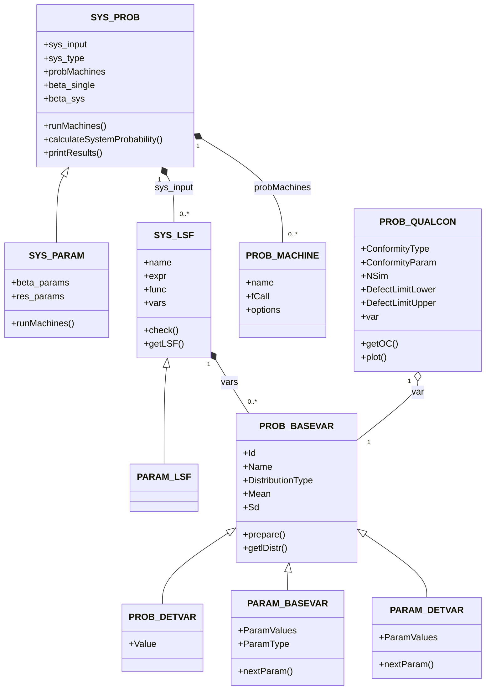
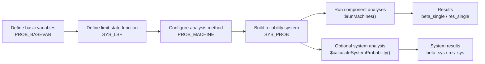

# TesiproV

<!-- badges: start -->
<!-- badges: end -->

The goal of TesiproV is to provide a flexible framework for
probabilistic reliability analysis of structural systems. It implements
several state-of-the-art algorithms (FORM, SORM, MVFOSM and Monte-Carlo
methods) and supports parametric studies through reference classes such
as `SYS_PROB`, `SYS_PARAM`, and `SYS_LSF`.

## Class structure

TesiproV is built around reference classes for modelling probabilistic
systems, limit-state functions, basic variables, and reliability methods.



## Architecture

TesiproV separates the probabilistic model from the numerical solution
algorithms.

The probabilistic model is represented by reference classes:

- `SYS_PROB` represents a reliability system and combines one or more
  limit-state functions with one or more analysis methods.
- `SYS_LSF` defines a limit-state function and its associated basic
  variables.
- `PROB_BASEVAR` represents a probabilistic basic variable including its
  distribution model and parameters.
- `PROB_MACHINE` stores the configuration of an analysis method.
- `SYS_PARAM` extends `SYS_PROB` to perform parametric studies.
- `PROB_QUALCON` describes a quality-control sampling plan for a basic
  variable and computes its OC curve. `PROB_BASEVAR$updateBasevar()` uses
  it to derive the distribution of the variable after acceptance.

The numerical reliability algorithms are implemented as functions.
This includes FORM, SORM, MVFOSM, crude Monte Carlo simulation,
importance sampling, and subset simulation.

This separation allows the algorithms to be used both through a `SYS_PROB` object and directly as standalone functions where appropriate.

**Note:** The reliability algorithms are intentionally implemented as
functions rather than reference classes. This keeps the public API
simple and allows direct use of individual methods independently from
the system-model classes.

### Typical analysis workflow




## Installation

The stable release of TesiproV is available on CRAN:

``` r
install.packages("TesiproV")
```

The development version can be installed from the GitLab server of
TU Dortmund University:

``` r
# install.packages("remotes")
remotes::install_gitlab("ls-massivbau/tesiprov", host = "gitlab.tu-dortmund.de")
```

Repository: <https://gitlab.tu-dortmund.de/ls-massivbau/tesiprov>.
If you need any permissions, please contact the project authors (see below).

## Parallel computing configuration

The Monte Carlo methods `MC_CRUDE()` and `MC_IS()` can evaluate the limit-state
function in parallel. Without the argument `backend` they run sequentially on
every system. TesiproV never changes the global `future` plan.

- `backend = "future"`: the chunks are evaluated under the active `future`
  plan, which also determines the number of workers. Set the plan yourself:

  ``` r
  future::plan(future::multisession, workers = 4) # Windows
  future::plan(future::multicore, workers = 4)    # Linux / macOS
  ```

- `backend = "parallel"`: `use_threads` sets the number of workers
  (`mclapply()` on Linux / macOS, a PSOCK cluster on Windows).

All random numbers are generated in the master process. With a fixed `seed`
the result does not depend on the number of workers.

Worker processes (backend `multisession` or PSOCK) load the **installed**
version of TesiproV. Install the package before running parallel analyses.
Loading the source with `devtools::load_all()` is not sufficient for the
workers.

## Example

This is a basic example which shows how to define a limit-state function
and run a FORM analysis:

``` r
library("TesiproV")
Var1 <- PROB_BASEVAR(Id = 1, Name = "X1", DistributionType = "norm", Mean = 0.25, Sd = 1) # kN/m²
Var2 <- PROB_BASEVAR(Id = 2, Name = "X2", DistributionType = "norm", Mean = 0.25, Sd = 1) # m

lsf <- SYS_LSF(vars = list(Var1, Var2), name = "UQLab 2d_hat")
lsf$func <- function(X1, X2) {
  return(20 - (X1 - X2)^2 - 8 * (X1 + X2 - 4)^3)
}

form <- PROB_MACHINE(name = "FORM Rack.-Fieß.", fCall = "FORM")

ps <- SYS_PROB(
  sys_input = list(lsf),
  probMachines = list(form)
)
ps$runMachines()
```

``` r
ps$beta_single
#>                     UQLab 2d_hat
#> FORM Rack.-Fieß. 3.4345652859862
```

## Parametric study example

A simple sweep over different mean values can be performed with
`PARAM_BASEVAR` and `SYS_PARAM`:

``` r
pvar <- PARAM_BASEVAR(
  Name = "E_mod",
  DistributionType = "norm",
  ParamType = "Mean",
  ParamValues = c(30e3, 35e3, 40e3),
  Sd = 3000
)

lsf_param <- SYS_LSF(vars = list(pvar), name = "ParamStudy")
lsf_param$func <- function(E_mod) {
  E_mod / 1000 - 30
}

machine_form <- PROB_MACHINE(name = "FORM", fCall = "FORM")

ps_param <- SYS_PARAM(
  sys_input = list(lsf_param),
  probMachines = list(machine_form)
)
ps_param$runMachines()
print(ps_param$beta_params)
```

## System reliability

`SYS_PROB$calculateSystemProbability(calcType, params)` evaluates systems
of several limit-state functions (`sys_type = "serial"` or `"parallel"`).
Available methods:

| `calcType` | Method |
|------------|--------|
| `"simpleBounds"` | Bounds from the single reliability indices of `runMachines()`. The machines can be FORM, SORM or others. |
| `"MCIS"` | Importance sampling for serial and parallel systems. |
| `"MCC"` | Crude Monte Carlo on the system limit-state function. |
| `"MCSUS"` | Subset simulation on the system limit-state function. |

A system analysis by FORM or SORM is not available. SORM and FORM only
provide single results that enter the simple bounds.

## Quality control and Bayesian updating

`PROB_QUALCON` defines a sampling plan and computes its OC curve, i.e. the
acceptance probability as a function of the defect fraction. The plan is
chosen with `ConformityType`:

- `"fck_EN-206"`: conformity criterion of EN 206 for the compressive
  strength. `ConformityParam = c(n)` holds the sample size. The OC curve is
  simulated, the Monte-Carlo sample size per defect fraction is set with the
  field `NSim` (default 100000). The characteristic strength $f_{ck}$ is
  given as `DefectLimitLower`.
- `"dim_k||n"`: attribute plan, a lot is accepted if at most `c_accept` of
  `n` units are defective. `ConformityParam = c(n, c_accept)`. A unit is
  defective if it lies below `DefectLimitLower` or above
  `DefectLimitUpper`. Both limits are freely selectable.

`DefectLimitLower` and `DefectLimitUpper` only define when a unit counts
as defective. The acceptance criterion is determined by the sampling plan.
The OC curve can also be specified manually with `theta_grid` and
`Pa_grid`.

``` r
fc <- PROB_BASEVAR(Id = 1, Name = "fc", DistributionType = "lt",
                   DistributionParameters = c(3.75, 0.105, 3, 10))

plan <- PROB_QUALCON(Name = "EN206_n15", ConformityType = "fck_EN-206",
                     ConformityParam = c(15), DefectLimitLower = 30, var = fc)
plan$getOC()
plan$plot()

fc_post <- fc$updateBasevar(plan)
```

The prior variable must have the distribution type `"st"` (Student-t) or
`"lt"` (log-Student-t) with the hyperparameters `c(m', s', n', v')`.
`updateBasevar()` returns a new `PROB_BASEVAR` and leaves the prior
unchanged.

## Recent changes

Version 1.0.0 is a consolidated release based on more than two years of
use. It solves single limit-state functions as well as systems.

- New: quality control with `PROB_QUALCON` (plans `"fck_EN-206"` and
  `"dim_k||n"` with freely selectable defect limits) and Bayesian updating
  via `PROB_BASEVAR$updateBasevar()`.
- Revised importance sampling for systems (`"MCIS"`) and an overview of the
  available system methods (see above).
- `MC_CRUDE` and `MC_IS` never change the active `future` plan. Without
  `backend` they run sequentially.
- FORM with `optim_type = "auto"` reports a switch from SLSQP to iHLRF in
  the result field `fallback`.
- Parallel workers need the installed package, no further packages have
  to be installed separately.

Version 0.9.5 introduces major refactoring:

- Improved consistency between probabilistic objects (`SYS_PROB`,
  `SYS_PARAM`, …).
- Corrected implementation of the Gumbel distribution in `$prepare()`.
- Enhanced error handling in `$check()` for limit-state functions.
- Automatic parallel plan configuration via `.onLoad()` with capped
  worker pool (default 4 cores).
- Added new distribution type: Empirical (`"emp"`).

For a complete changelog see **NEWS.md**.

## Further information

For more, check out the vignette! There are plenty more demonstrations
and detailed explanations for each object class.

You can open it directly in R:

``` r
vignette("TesiproV-Vignette")
```

# Contact & Citation

If you use TesiproV for research or teaching, please cite it as:

> Lux T., Nille-Hauf K., Feiri T., Ricker M. (2026): *TesiproV —
> Probabilistic Reliability Analysis Framework*. TU Dortmund University.

For questions or bug reports please contact
<tesiprov.lmb.ab@tu-dortmund.de>.

------------------------------------------------------------------------

## License

TesiproV is licensed under the [MIT
License](https://opensource.org/licenses/MIT).  
You are free to use, modify and redistribute the software provided that
the original copyright notice and license terms are retained.

© 2021-2026 Til Lux, Konstantin Nille-Hauf, Tania Feiri, Marcus Ricker —
TU Dortmund University / Hochschule Biberach.
